# Lab 6 — Planetas, estrellas y pelotas con shaders procedurales

**Autor:** Javier Alvarado — 24546

Seis cuerpos (tres celestes y tres deportivos) dibujados con la **misma esfera** (`assets/sphere.obj`, sin modificar vértices),
cada uno con un fragment shader distinto calculado en CPU. Todo es matemático: ruido Simplex 3D hecho a
mano, fBm, umbrales, senos y mezcla de colores. No hay texturas ni imágenes externas.

| Estrella | Planeta rocoso | Gigante gaseoso |
|---|---|---|
| 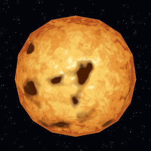 | 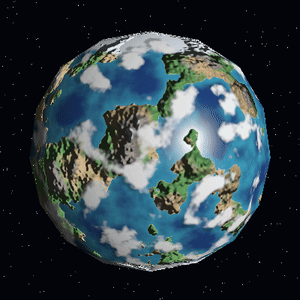 | 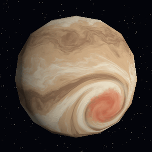 |

| Fútbol | Basquetbol | Beisbol |
|---|---|---|
| 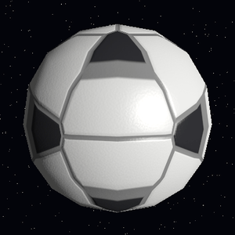 | 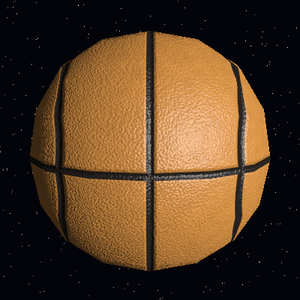 | 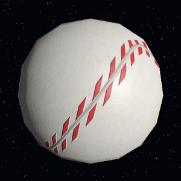 |

### Video de demostración

[](https://youtu.be/OBQX8rROXrI)

[▶ Ver el video completo en YouTube](https://youtu.be/OBQX8rROXrI)

## Compilar y ejecutar

Requiere Rust (edición 2024). Única dependencia: `minifb` (ventana).

```bash
cargo run --release            # ventana interactiva (framebuffer 400x400, escalado x2)
```

### Controles

| Tecla | Acción |
|---|---|
| `1` / `2` / `3` | Estrella / planeta rocoso / gigante gaseoso |
| `4` / `5` / `6` | Fútbol / basquetbol / beisbol |
| Flechas | Rotar la cámara (órbita) |
| `Q` / `E` | Mover la luz alrededor del planeta (ver día/noche, especular, bump) |
| `Z` / `X` | Menos / más cobertura de nubes (planeta rocoso) |
| `R` | Reiniciar cámara, luz y nubes |
| `P` | Guardar captura PNG del framebuffer en `capturas/` |
| `Esc` | Salir |

El tiempo global avanza una cantidad fija por frame (`DT` en `src/main.rs`).

### Modo sin ventana (capturas y GIF)

```bash
# Una captura: --body 1..6, con tiempo, cámara y luz en grados
./target/release/lab6 --body 2 --time 0 --yaw 0 --pitch 8 --light 135 --cloud 0.3 --out assets/planeta_noche.png

# Secuencia de PNG para el GIF (90 frames, la cámara gira 90° durante la secuencia)
./target/release/lab6 --body 2 --frames 90 --dir assets/frames_2 --light 40 --spin 90 --speed 3
ffmpeg -y -framerate 30 -i assets/frames_2/f%04d.png -vf "scale=300:-1:flags=lanczos,split[a][b];[a]palettegen[p];[b][p]paletteuse" assets/anim_2.gif
```

## Arquitectura

| Archivo | Contenido |
|---|---|
| `src/main.rs` | Ventana, input, tiempo, capturas, modo sin ventana |
| `src/render.rs` | Framebuffer, z-buffer, rasterizado con baricéntricas (corrección de perspectiva), cámara orbital, reparto del fragment shader en hilos |
| `src/obj.rs` | Cargador OBJ (v / vt / vn) |
| `src/png.rs` | Escritor PNG propio (sin dependencias) |
| `src/noise.rs` | Simplex 3D, fBm, hash |
| `src/math.rs` | `Vec3`, `smoothstep`, rotaciones |
| `src/shaders/{star,rocky,gas_giant,soccer,basketball,baseball}.rs` | Un shader por cuerpo, con constantes comentadas al inicio |

Pipeline: vértices → pantalla → rasterizado con z-buffer (guarda triángulo y baricéntricas por píxel) →
fragment shader por píxel con posición, normal, uv y dirección de vista interpolados.
El ruido siempre usa la **posición 3D normalizada en espacio de objeto**, no las UV (sin costuras ni
distorsión en los polos). `sphere.obj` trae pocas caras (192 triángulos) y normales planas por cara, por
eso la normal del fragmento se toma como `normalize(posición)` (constante `SMOOTH_SPHERE_NORMALS` en
`render.rs`); la silueta sí queda poligonal porque la geometría no se toca.

Rendimiento: ~7 ms/frame (estrella y gas) y ~13 ms (rocoso) a 400x400 en 24 hilos; fBm con 3–5 octavas.

---

## Cuerpos celestes

### 1. Estrella — `src/shaders/star.rs`

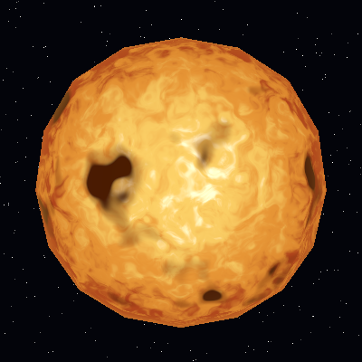

**Diseño:** sol emisivo (no usa la luz), núcleo blanco-amarillo, bordes naranja-rojizos, manchas oscuras.

**Patrones y cómo se combinan:**
1. *Granulación:* fBm (4 octavas) con domain warping (otro fBm deforma la coordenada), desplazado en el tiempo.
2. *Temperatura:* `heat = f(mu) + granulación`, donde `mu = normal·vista` (centro = caliente). Una rampa
   rojo oscuro → naranja → amarillo → blanco la convierte en color.
3. *Manchas solares:* fBm distinto, rotado lentamente y evolucionando en el tiempo, umbralizado en dos
   niveles (penumbra y umbra), desvanecido cerca de los polos.
4. *Limb darkening:* se oscurece y enrojece hacia el borde (`mu`), más un halo naranja fino.

**Parámetros:** `TURB_FREQ`, `TURB_SPEED`, `WARP_STRENGTH`, `SPOT_UMBRA`/`SPOT_PENUMBRA`, `SPOT_FREQ`,
`LIMB_POWER`, `RIM_GLOW`, y los colores `COL_*`.

### 2. Planeta rocoso — `src/shaders/rocky.rs`

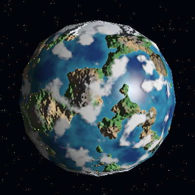

**Diseño:** océanos con reflejo del sol, costas de arena, continentes verdes/desérticos, montañas rocosas
con cumbres nevadas, casquetes polares, nubes, relieve, ciudades de noche.

**Patrones y cómo se combinan:**
1. *Altura:* fBm de 5 octavas → `elev = altura − SEA_LEVEL`.
2. *Biomas por umbrales suaves (`smoothstep`):* océano (profundo→somero), arena, pasto/desierto (mapa de
   humedad = otro fBm), roca por altura, nieve en cumbres.
3. *Hielo polar:* por latitud `|y|`, con borde irregular por ruido.
4. *Iluminación:* difusa con normal perturbada por bump; especular Blinn-Phong solo en océano.
5. *Nubes:* fBm distinto, con la coordenada rotada alrededor de Y a `CLOUD_SPEED`; el terreno queda fijo.
6. *Sombras de nubes* y *luces de ciudad* (ver tabla de efectos).

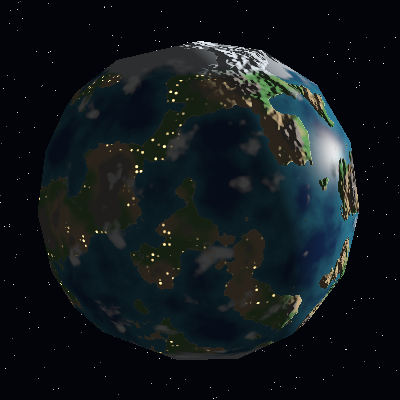

**Parámetros:** `TERRAIN_FREQ`, `SEA_LEVEL`, `ICE_LATITUDE`, `MOUNTAIN_START`, `SNOW_START`,
`BUMP_STRENGTH`, `SPEC_POWER`, `CLOUD_FREQ`, `CLOUD_SPEED`, `SHADOW_OFFSET`, `CITY_FREQ`; la cobertura de
nubes se cambia en vivo con `Z`/`X`.

### 3. Gigante gaseoso — `src/shaders/gas_giant.rs`

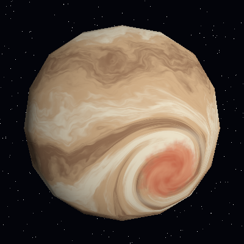

**Diseño:** bandas crema/ocre/café de aspecto líquido y una gran tormenta roja que enrosca las bandas.

**Patrones y cómo se combinan:**
1. *Tormenta:* el punto se rota (Rodrigues) alrededor del centro de la tormenta con un ángulo que decae
   gaussianamente con la distancia → las bandas se curvan en espiral.
2. *Domain warping:* la latitud del punto ya torcido se perturba con fBm animado lentamente.
3. *Bandas:* senos de dos frecuencias sobre la latitud perturbada, más vetas alargadas (ruido estirado en Y).
4. *Interior de la tormenta:* color rojo/salmón con remolinos del mismo ruido torcido y un anillo claro en el borde.
5. Luz difusa simple.

**Parámetros:** `BAND_FREQ`, `WARP_STRENGTH`, `WARP_SPEED`, `STREAK_AMOUNT`, `STORM_CENTER_LAT/LON`,
`STORM_RADIUS`, `STORM_TWIST`.

### 4. Fútbol — `src/shaders/soccer.rs`

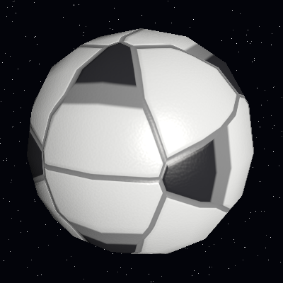

**Diseño:** balón de icosaedro truncado: 12 pentágonos negros y 20 hexágonos blancos con costuras grises.

**Patrones:** cada punto se asigna a la celda (32 centros: vértices del icosaedro y caras) con mayor
`dot(p, centro) + sesgo`; la diferencia entre las dos mejores puntuaciones es la distancia a la costura.
Costuras hundidas y cuero fino por bump mapping, brillo Blinn-Phong moderado.

**Parámetros:** `HEX_BIAS`, `SEAM_WIDTH`, `BUMP_STRENGTH`.

### 5. Basquetbol — `src/shaders/basketball.rs`

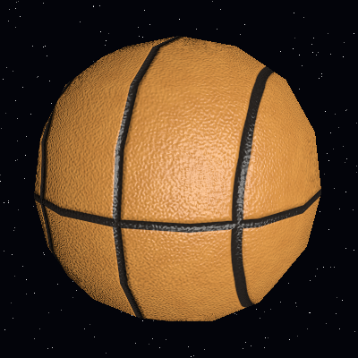

**Diseño:** cuero naranja granulado con líneas negras: ecuador, meridiano y dos arcos laterales.

**Patrones:** distancia a círculos máximos/menores (`line_dist`) umbralizada con `smoothstep`; tono
variable con fBm y granulado de alta frecuencia como bump; acabado casi mate.

**Parámetros:** `LINE_WIDTH`, `SIDE_ARC`, `PEBBLE_FREQ`, `PEBBLE_AMP`.

### 6. Beisbol — `src/shaders/baseball.rs`

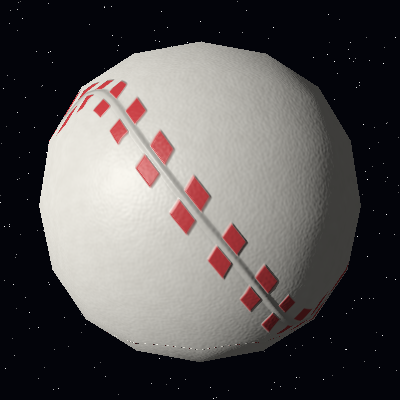

**Diseño:** cuero blanco con costura roja curva y puntadas en V.

**Patrones:** la costura es la curva `y = A·sin(2φ)` (φ = longitud); se calcula la distancia con signo a
la curva y las puntadas son una onda triangular en φ desfasada según el lado (forma de V), con la
costura elevada y sombreada por bump.

**Parámetros:** `AMPLITUDE`, `STITCH_COUNT`, `STITCH_SLANT`, `STITCH_DUTY`.

Las pelotas no giran solas (igual que el terreno de los planetas); `BALL_SPIN` en `src/shaders/mod.rs`
permite activar un giro. Los GIF muestran la cámara orbitando.

---

## Efectos solicitados

| Efecto (pts) | Cuerpo | Archivo / función | Parámetro modificable → qué cambia |
|---|---|---|---|
| Nubes procedurales (10) | Rocoso | `rocky.rs` · `cloud_mask()` y final de `shade()` | `Uniforms::cloud_coverage` (teclas `Z`/`X`) → más/menos nubes; `CLOUD_SPEED` → rapidez de giro, distinta al terreno |
| Tormenta / vórtice (10) | Gaseoso | `gas_giant.rs` · `shade()` (rotación `rotate_axis` + `falloff`) | `STORM_TWIST` → cuánto se enroscan las bandas; `STORM_RADIUS` → tamaño |
| Bump mapping (15) | Rocoso | `rocky.rs` · `bump_height()` y bloque "Bump mapping" en `shade()` | `BUMP_STRENGTH` → relieve más/menos marcado (se nota al mover la luz con `Q`/`E`) |
| Material animado (5) | Estrella (y gas) | `star.rs` · `shade()` (warp + manchas con `t`); `gas_giant.rs` (`WARP_SPEED`) | `TURB_SPEED`, `SPOT_EVOLVE` → rapidez a la que hierve la superficie y evolucionan las manchas |
| Respuestas distintas a la luz (10) | Rocoso | `rocky.rs` · `shade()` (`spec`, `ocean_w`) | `SPEC_POWER` / `SPEC_STRENGTH` → tamaño e intensidad del brillo del océano; la tierra es mate |
| Día y noche (5) | Rocoso | `rocky.rs` · `city_lights()` y bloque "Noche" en `shade()` | `NIGHT_THRESHOLD` → dónde empieza la zona con luces; `CITY_FREQ` → densidad de ciudades |
| Sombras de nubes (20, opcional) | Rocoso | `rocky.rs` · `shade()` (`shadow_clouds`, `shadow`) | `SHADOW_OFFSET` → separación de la sombra; `SHADOW_DARKNESS` → oscuridad |

Capturas para el efecto de cobertura (`Z`/`X`):

| 15 % | 85 % |
|---|---|
| 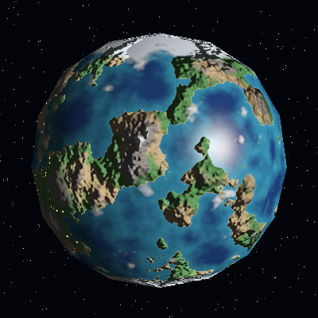 | 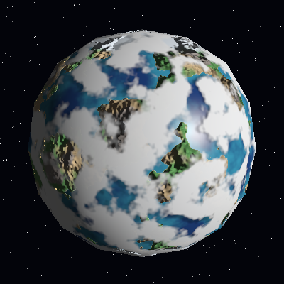 |

GIF/video de animación: `assets/anim_1.gif` a `anim_6.gif` (estrella, rocoso, gaseoso, fútbol, basquetbol,
beisbol) y el [video en YouTube](https://youtu.be/OBQX8rROXrI); se regeneran con los comandos de "Modo sin ventana".
